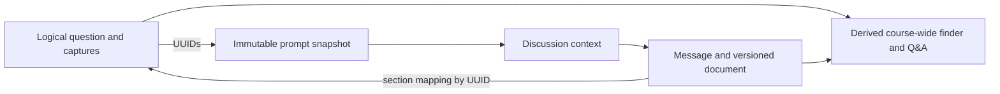

# Discussions, discovery, and action audit — 16 September 2026

## User priority

Finding a question or its answer, with the existing Q&A reading/editing workflow
preserved. Also investigate deletion inconsistencies and collect a few days of
local interaction metadata to identify repeated manual work.

## Findings and changes

| Finding | Result |
|---|---|
| Finding an answer depended on selecting the right resource/day conversation first. | Course-wide **Find questions & answers** searches question text, answer text, source/chapter context, immutable IDs, and historical prompt aliases. |
| Search could miss responses not yet marked understood. | Search uses parsed answer sections and UUID mappings, independently of the understood flag. |
| One question can have several visual captures and answer versions. | One result per logical question; open its existing Q&A history, including follow-ups. No new persisted answer copies. |
| Deleted source questions can leave useful historical answers. | Nonempty unlinked responses remain searchable and open their exact conversation message. They are never silently reassigned by a reused Q label. |
| Deleting the final answer saved an empty, active message. | Final-section deletion soft-deletes the message, checks message **and document** revisions, retains history, and applies the reopen/archive choice. |
| Whole-conversation deletion skipped ordinary response cleanup. | It now uses the same message cleanup, preserving task-note synchronization and removing answer links/review captures consistently. |
| Deleting one response reopened a question with another canonical answer, or an archived question. | Reopen only understood questions without another living `answers` link. Archived questions stay archived. |
| 16 historical empty assistant messages remained active. | Migration 0025 retires only empty Markdown/plain-text messages with null editor JSON, no links, and no living review captures. Documents/revisions remain intact. |
| “Go to answer” targeted an element that was never rendered. | Opens the question in Q&A. |
| “New discussion” could retain an older selected conversation. | Focus the returned new thread ID. |
| A failed conversation deletion could still show a success message. | Navigation and success occur only after the mutation succeeds. |
| Resource Q&A created an empty thread just to look for answers. | Read-only lookup; it can use an existing mapped answer in another scope. |
| Task Q&A required a day thread even when a resource thread contained its answers. | Fall back to a thread with the task's mapped answers; open all answers initially. |
| Task “Copy next” required a manual day-discussion setup. | Create the first discussion from the saved prompt snapshot when needed. |
| Copying an empty resource queue created empty prompts/conversations. | Explain the empty queue and open the existing context without creating records. |
| Notes “Discuss” lost the selected question's identity. | Answered captures now open their own Q&A; other captures open their discussion context. |
| Archived threads could win an implicit resource selection. | Exclude archived threads from implicit routing; explicit archived navigation remains available. |
| Conversation navigation mixed counts and scopes. | Separate finder/conversation modes; searchable conversation list, archive toggle, scope labels, nonempty-message counts. Resource progress is labelled “Questions understood.” |

### Consistent action vocabulary

- **Copy task prompt**: task title, instructions, note, and linked questions.
- **Copy next**: the pending question queue for the stated task/source.
- **Import review**: task review importer with its preview and task-note linkage.
- **Paste response**: conversation response importer.
- **Q&A / Open Q&A**: review existing answers; no creation as a side effect.
- **Open discussion**: navigate to context; **New discussion** explicitly creates it.
- Legacy coverage mapping controls explicitly say they target the **latest response**.

## Entry-point and data-model audit

| Entry point | Data created or used | Destination |
|---|---|---|
| Day prompt / day questions | Immutable prompt batch with day/task scope; thread linked to that batch | Day conversation |
| Task Copy task prompt / Copy next | Prompt snapshot and original question UUIDs; reuse a day thread or create it after saving the first batch | Clipboard, then Import review/Q&A |
| Task Import review | Idempotent import; fixed original-work question, linked assistant message, tagged task-note mirror | Task-scoped Q&A |
| Resource Copy next | Resource queue, canonical captures, stable IDs; selection dialog for large queues | Resource conversation |
| Task/resource Q&A | Existing question UUIDs and answer sections across conversations | Existing Q&A modal |
| Resource/task card discussion buttons | Resource context, plus task context where available | Conversation; no read-time insert |
| Notes Discuss questions | Course question prompt snapshot | New explicitly requested conversation |
| Notes individual question | Selected annotation UUID; logical captures/answer history | That question's Q&A when mapped |
| Conversation Paste response | Imported sections, independent message documents/revisions, scoped links | Selected conversation |
| Editor Ask / extracted follow-ups | Annotation anchored to parent message; root-question UUID metadata | Existing question thread / next prompt |
| Standalone response Review in Q&A | Explicit review-source annotation for the existing message | Q&A without duplicating the response |
| Search result | Derived index only, no storage changes | Question history or exact unlinked message |

The existing model already has the necessary identities. Retain its distinction:

Stable readable labels identify questions; old `Q-001` aliases belong to a
particular prompt/discussion. They are searchable aliases, never global foreign
keys. `answered` means **understood**, not merely “a response exists.” Task reviews
have a deliberate synchronized note mirror; ordinary answers have one canonical
message document. No wholesale editor rewrite or duplicate answer database is
needed for these discovery/deletion fixes.

## Usage observation

Debug → **Usage & friction**:

- Starts a three-day local recording window on first installation; stops
  automatically. Stop, restart for three days, or delete usage data and stop.
- Separate `<database>.usage.sqlite`, excluded from study backups. Secure deletion,
  seven-day expiry on startup/hourly/access, maximum 50,000 events. Retry UUIDs
  prevent duplicates; a bounded client queue cannot block study mutations.
- Strict allowlisted action/view values and UUID context. Counts, timestamps,
  durations, and success/error outcomes only. Unknown fields/actions are rejected.
- No tutor/notes text, search phrases, clipboard, key values, URLs, or screenshots.
- Important question/task/Q&A actions have distinct names. Remaining buttons,
  changes, expansions, and editor entry are grouped by control type.
- Focused/visible time is counted in at most ten-second slices while input/scroll
  activity occurred in the last thirty seconds. Quiet reading is undercounted;
  time is an observation, not an inefficiency score.
- Settled question-search changes record result counts after 800 ms. API latency
  and errors are separate from user action counts. Usage transport is not logged
  into itself.
- Per-day or retained-week report: active minutes by view, action frequencies,
  empty searches, slow/failing API requests, rapid repeated actions, common next
  actions in the same session within thirty seconds. Export aggregates as JSON.

After a few normal study days, compare the counts with actual study intent.
Prioritize repeated manual actions and empty searches, then use sequences to
choose which workflow to inspect. A fast double-click or long reading session is
not by itself a defect. No conclusion about the user's real friction has yet been
drawn from the synthetic/browser verification activity.

## Limits and follow-up opportunities

- Search covers stored text and source metadata, not OCR inside screenshots.
- Search is a derived in-memory course index; no unrelated legacy FTS-table repair.
- Finder filters survive opening/closing Q&A, but are not durable bookmarks across
  reloads. Existing conversation links remain compatible.
- Generic control categories cannot identify every individual button or task.
  Add specific action names where the first observation period shows a need.
- Explicit conversation creation may legitimately leave a thread with no messages;
  its single “ready for its first message” state remains. Empty message cards do not.
- Historical nonempty orphan answers are retained; review and relink them explicitly
  rather than inferring identity from old labels.
- Existing Q&A grouping/review behavior is preserved; a logical question may include
  several answer groups and follow-ups.

## Validation

Final automated checks and deployment verification are recorded in the feature log.
Browser checks use an isolated database copy: exact-ID search, text search,
zero-result state, matching Q&A/history, returning to retained search, rendered math
previews, conversation filtering, no blank cards, and usage summary collection.
